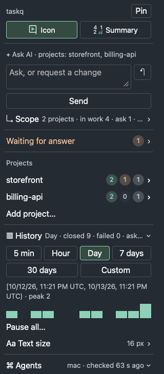
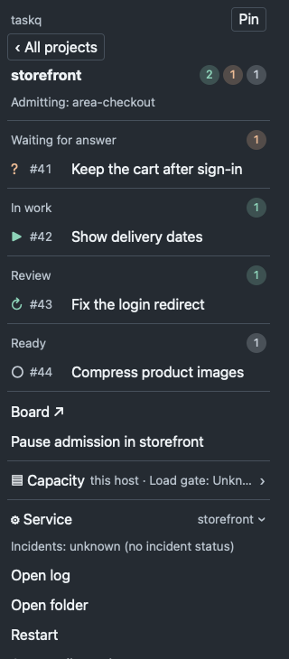

<p align="center">
  
  <br><em>Agents working.</em>
</p>

```text
Install taskq from https://github.com/taskqorg/taskq and set it up for this project.
```

Paste into Claude or Codex; the agent confirms setup changes, installs taskq, connects the board and becomes the manager.
For a new project:

```text
Install taskq from https://github.com/taskqorg/taskq and create project <name> from <idea or folder>.
```

Your repository board is the task list; your usual AI apps do the work.

### What you get

- Tasks are issues on GitHub or GitLab.
- The service runs Claude or Codex workers within each computer's configured limits.
- A worker's question waits for your answer.
- A reviewer checks the result; accepted work publishes through the configured branch or PR route.
- The tray menu shows questions, admission controls and a day's history.
- Several computers share one board.

### See the queue

Synthetic storefront data, captured from the dark tray menu. These are examples, not a live project's progress. Open an image for its original size.

[](docs/shots/popover-dark-home-16.png)

[](docs/shots/popover-dark-project-16.png)


### From request to reviewed work

Illustrative dialogue, not recorded sessions. The three scenes follow one storefront change; task numbers and outcomes are examples. Start with an installed project, an accessible board and a manager that has loaded the project rules.

#### 1. Agree the work before starting

Customers lose their cart when they sign in. The owner also wants them returned to the page they came from.

> **Owner:** Fix sign-in so customers can continue shopping. Plan the work first.  
> **Manager:** Should this include merging a guest cart into an existing account cart, or just returning to the right page? That changes the acceptance checks.  
> **Owner:** Both. Keep them as separate tasks. Show me the checks before starting.  
> **Manager:** I suggest #41 for cart preservation and #43 for the return page. Check both fresh and existing account carts, and reject external redirect destinations. The tasks can run independently.  
> **Owner:** Agreed. File them held, then start those two.

The manager creates the agreed issues, reads them back and starts them. Eligible workers run within the host's limits. The observable result is two linked issues with acceptance checks and their actual queue states; filing them alone does not prove work started.

Sources: [UC-02](docs/use-cases/README.md#uc-02-manage-a-project-through-an-agent), [UC-03](docs/use-cases/README.md#uc-03-move-from-idea-to-implementation), [UC-07](docs/use-cases/README.md#uc-07-turn-a-large-plan-into-dependent-and-parallel-tasks).

#### 2. Resolve a question without guessing

The cart worker finds that the same product can exist in both carts. Task #41 waits for an owner decision.

> **Owner:** What is blocking the cart fix?  
> **Manager:** #41 needs a quantity rule: 1. Keep the larger quantity, or 2. Add the quantities. The worker recommends 1 to avoid accidental duplicates.  
> **Owner:** Keep the larger quantity. Does that also cover a product that is now out of stock?  
> **Manager:** No. That needs a separate acceptance condition; the current choice only settles duplicate quantities.  
> **Owner:** Answer #41 with 1. Also tell the worker to retain unavailable items with a warning, without allowing checkout for them.

The manager reads the current question, posts the selected answer and sends the additional instruction to #41. Readback must show both before reporting success. The service resumes the same attempt when it can. If the question changed, the manager refreshes it instead of answering an old card.

Source: [UC-09](docs/use-cases/README.md#uc-09-answer-without-leaving-the-task). This example uses the manager and board; it does not promise every proposed inline conversation control.

#### 3. Accept evidence, then deliver

The redirect worker submits #43 with a candidate commit, checks and a PR. Creating the PR has not delivered the fix to users.

> **Owner:** Is the redirect fix ready?  
> **Manager:** The result has passing checks, but the browser evidence does not cover an expired session. Accept this scope or send it back for that case?  
> **Owner:** Send it back. Expired sessions must return safely too.  
> **Manager:** The reviewer returned #43 with that missing check. The replacement result now includes it; the reviewer must check the new commit and its CI.  
> **Owner:** Once that exact candidate passes review, publish the PR through our agreed route.

The reviewer checks the replacement against acceptance and the configured publication requirements. Only successful publication readback establishes that the branch or PR was published. Deployment to a running storefront needs its own evidence; closing a TaskQ task does not prove it.

Source: [UC-14](docs/use-cases/README.md#uc-14-review-evidence-and-deliver). The manager relays evidence and owner decisions; it does not replace the reviewer.

Agents: install, setup, commands and development are in **[taskq.md](taskq.md)**.

Verify a downloaded release file: check it against the release's `SHA256SUMS` (`shasum -a 256 -c SHA256SUMS --ignore-missing`),
then trace it to the workflow run that built it with `gh attestation verify <file> --repo taskqorg/taskq`.

License: [MIT](LICENSE).

If taskq saves you time, [buy me a coffee](https://alex.kirs.online/donate).
